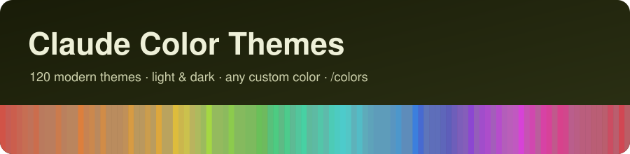
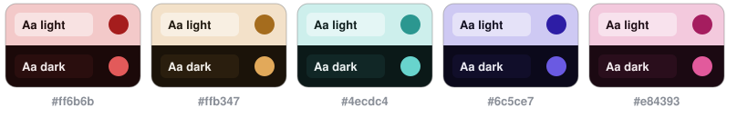
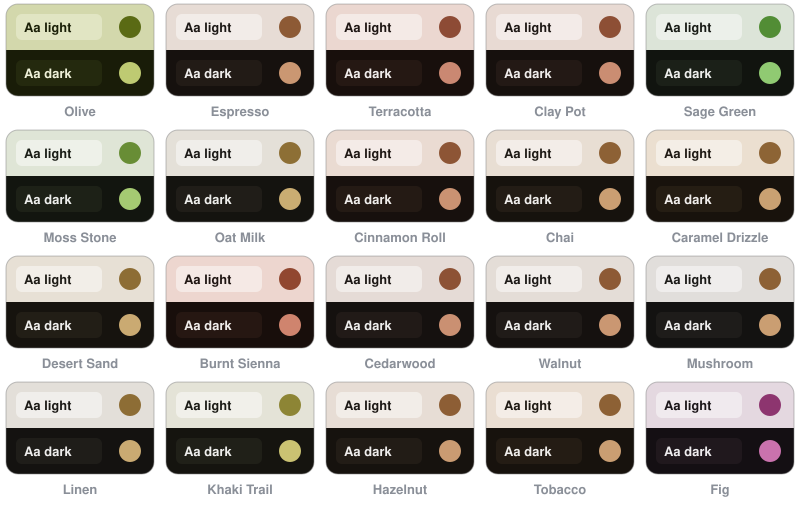
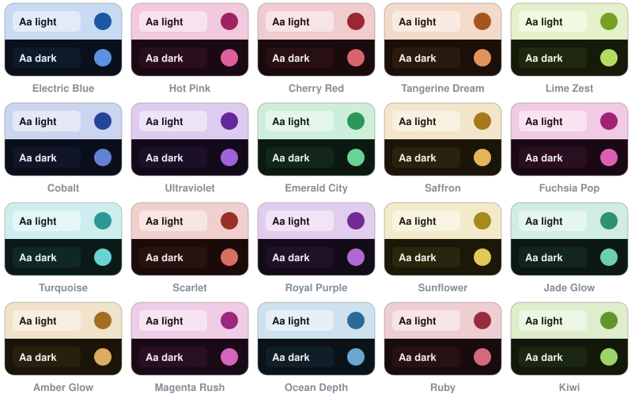
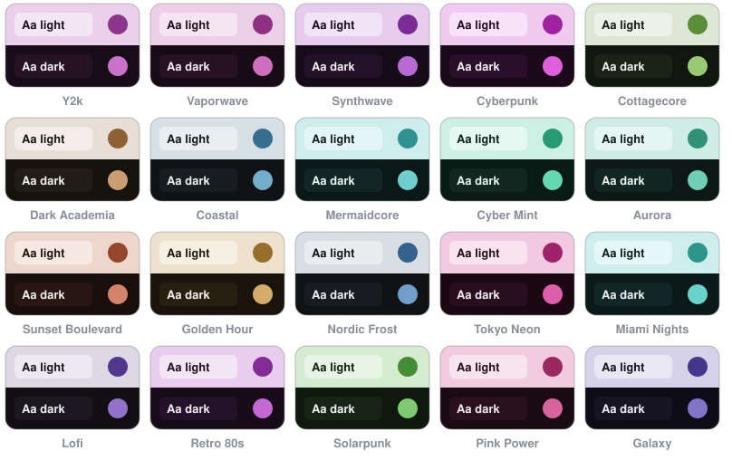
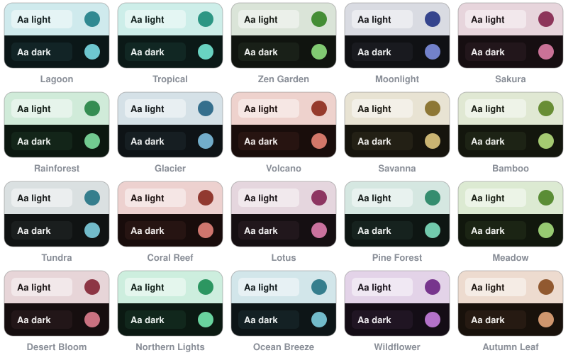

<p align="center">
  
</p>

<p align="center">
  
  
  
  
</p>

<p align="center">
  <b>Give your Claude app a whole new mood.</b><br>
  Pick from 120 hand-named modern palettes, from <i>Matcha Latte</i> to <i>Tokyo Neon</i>, or turn any hex color into a full theme.
</p>

<p align="center">
  <a href="#-install">Install</a> •
  <a href="#-how-to-use">How to use</a> •
  <a href="#-custom-colors">Custom colors</a> •
  <a href="#-gallery">Gallery</a> •
  <a href="#-every-theme">Every theme</a>
</p>

---

## ✨ Features

- 🎨 **120 themes** in six curated collections: pastels, earthy, vibrant, moody, aesthetic and nature
- 🌗 **Light and dark** versions of every theme, designed as a pair rather than simply inverted
- 🖌️ **Custom colors:** type any hex color and get a complete, readable theme built around it
- 💾 **Remembers your pick** across sessions
- 🎲 **`/colors random`** for when you can't decide
- ♿ **Readable by design:** every theme passes Claude's contrast checks, and red/green/amber keep their meaning

## 📦 Install

At the prompt of a Claude Code terminal session:

```
/plugin install olive-theme --marketplace notchkillerAI/claude-color-themes
```

Answer `y` to add the marketplace, then press **Enter** to install for your user.

<details>
<summary>Other ways to install</summary>

**From a shell**

```bash
claude plugin install olive-theme --marketplace notchkillerAI/claude-color-themes
```

**In the Claude desktop app**

1. Click **+** next to the prompt box
2. Choose **Plugins** → **Add marketplace**
3. Enter `notchkillerAI/claude-color-themes`
4. Click **Add plugin**

</details>

## 🚀 How to use

| Command | What it does |
| --- | --- |
| `/colors` | Show every theme and the one you're using |
| `/colors sakura` | Switch to a theme by name |
| `/colors golden hour` | Spaces work too, same as `golden-hour` |
| `/colors random` | Surprise me with a different theme |
| `/colors custom #7c9a5e` | Build a theme from your own color |

You start on **Olive**, a deep olive green. Your choice is saved, so it's still there next time.

## 🖌️ Custom colors

Don't see the exact shade you want? Make your own in three steps:

1. **Pick a color.** Grab a hex code from any color picker, such as [coolors.co](https://coolors.co), [Adobe Color](https://color.adobe.com), or the color picker in Google search.
2. **Type the command** with your hex code:
   ```
   /colors custom #ff6b6b
   ```
   The `custom` word and the `#` are optional: `/colors ff6b6b` works too.
3. **Enjoy.** Your color becomes the accent. The backgrounds and text are tinted from it, in both light and dark mode, with readable contrast built in.

Here's what a few custom colors turn into:

<p align="center">
  
</p>

> **Tip:** rich, mid-tone colors such as `#6c5ce7` make the most striking themes. Very pale or near-gray colors give a calm, subtle theme. To go back to a built-in theme, just type its name, for example `/colors olive`.

## 🖼️ Gallery

Each card shows the theme in light mode (top) and dark mode (bottom), with its accent color.

### 🌸 Soft pastels


### 🍂 Earthy & cozy


### ⚡ Bold & vibrant


### 🌙 Dark & moody


### 💿 Aesthetic vibes


### 🌿 Nature escapes


## 📋 Every theme

Click a collection to see every theme in it, the command to use it, and its key colors.

<details>
<summary><b>Soft pastels</b> — 20 themes</summary>

| Theme | Command | Light background | Dark background | Accent |
| --- | --- | --- | --- | --- |
| **Matcha Latte** | `/colors matcha-latte` |  |  |  |
| **Digital Lavender** | `/colors digital-lavender` |  |  |  |
| **Butter Yellow** | `/colors butter-yellow` |  |  |  |
| **Sorbet Peach** | `/colors sorbet-peach` |  |  |  |
| **Cotton Candy** | `/colors cotton-candy` |  |  |  |
| **Baby Blue** | `/colors baby-blue` |  |  |  |
| **Mint Cream** | `/colors mint-cream` |  |  |  |
| **Lilac Haze** | `/colors lilac-haze` |  |  |  |
| **Strawberry Milk** | `/colors strawberry-milk` |  |  |  |
| **Pistachio Gelato** | `/colors pistachio-gelato` |  |  |  |
| **Seafoam** | `/colors seafoam` |  |  |  |
| **Blush Pink** | `/colors blush-pink` |  |  |  |
| **Periwinkle** | `/colors periwinkle` |  |  |  |
| **Honeydew** | `/colors honeydew` |  |  |  |
| **Apricot Crush** | `/colors apricot-crush` |  |  |  |
| **Powder Blue** | `/colors powder-blue` |  |  |  |
| **Rose Quartz** | `/colors rose-quartz` |  |  |  |
| **Vanilla Bean** | `/colors vanilla-bean` |  |  |  |
| **Lemon Sorbet** | `/colors lemon-sorbet` |  |  |  |
| **Creamsicle** | `/colors creamsicle` |  |  |  |

</details>

<details>
<summary><b>Earthy & cozy</b> — 20 themes</summary>

| Theme | Command | Light background | Dark background | Accent |
| --- | --- | --- | --- | --- |
| **Olive** | `/colors olive` |  |  |  |
| **Espresso** | `/colors espresso` |  |  |  |
| **Terracotta** | `/colors terracotta` |  |  |  |
| **Clay Pot** | `/colors clay-pot` |  |  |  |
| **Sage Green** | `/colors sage-green` |  |  |  |
| **Moss Stone** | `/colors moss-stone` |  |  |  |
| **Oat Milk** | `/colors oat-milk` |  |  |  |
| **Cinnamon Roll** | `/colors cinnamon-roll` |  |  |  |
| **Chai** | `/colors chai` |  |  |  |
| **Caramel Drizzle** | `/colors caramel-drizzle` |  |  |  |
| **Desert Sand** | `/colors desert-sand` |  |  |  |
| **Burnt Sienna** | `/colors burnt-sienna` |  |  |  |
| **Cedarwood** | `/colors cedarwood` |  |  |  |
| **Walnut** | `/colors walnut` |  |  |  |
| **Mushroom** | `/colors mushroom` |  |  |  |
| **Linen** | `/colors linen` |  |  |  |
| **Khaki Trail** | `/colors khaki-trail` |  |  |  |
| **Hazelnut** | `/colors hazelnut` |  |  |  |
| **Tobacco** | `/colors tobacco` |  |  |  |
| **Fig** | `/colors fig` |  |  |  |

</details>

<details>
<summary><b>Bold & vibrant</b> — 20 themes</summary>

| Theme | Command | Light background | Dark background | Accent |
| --- | --- | --- | --- | --- |
| **Electric Blue** | `/colors electric-blue` |  |  |  |
| **Hot Pink** | `/colors hot-pink` |  |  |  |
| **Cherry Red** | `/colors cherry-red` |  |  |  |
| **Tangerine Dream** | `/colors tangerine-dream` |  |  |  |
| **Lime Zest** | `/colors lime-zest` |  |  |  |
| **Cobalt** | `/colors cobalt` |  |  |  |
| **Ultraviolet** | `/colors ultraviolet` |  |  |  |
| **Emerald City** | `/colors emerald-city` |  |  |  |
| **Saffron** | `/colors saffron` |  |  |  |
| **Fuchsia Pop** | `/colors fuchsia-pop` |  |  |  |
| **Turquoise** | `/colors turquoise` |  |  |  |
| **Scarlet** | `/colors scarlet` |  |  |  |
| **Royal Purple** | `/colors royal-purple` |  |  |  |
| **Sunflower** | `/colors sunflower` |  |  |  |
| **Jade Glow** | `/colors jade-glow` |  |  |  |
| **Amber Glow** | `/colors amber-glow` |  |  |  |
| **Magenta Rush** | `/colors magenta-rush` |  |  |  |
| **Ocean Depth** | `/colors ocean-depth` |  |  |  |
| **Ruby** | `/colors ruby` |  |  |  |
| **Kiwi** | `/colors kiwi` |  |  |  |

</details>

<details>
<summary><b>Dark & moody</b> — 20 themes</summary>

| Theme | Command | Light background | Dark background | Accent |
| --- | --- | --- | --- | --- |
| **Midnight Navy** | `/colors midnight-navy` |  |  |  |
| **Obsidian** | `/colors obsidian` |  |  |  |
| **Deep Forest** | `/colors deep-forest` |  |  |  |
| **Merlot** | `/colors merlot` |  |  |  |
| **Aubergine** | `/colors aubergine` |  |  |  |
| **Charcoal** | `/colors charcoal` |  |  |  |
| **Graphite** | `/colors graphite` |  |  |  |
| **Storm Cloud** | `/colors storm-cloud` |  |  |  |
| **Ink** | `/colors ink` |  |  |  |
| **Smoked Plum** | `/colors smoked-plum` |  |  |  |
| **Petrol** | `/colors petrol` |  |  |  |
| **Dark Chocolate** | `/colors dark-chocolate` |  |  |  |
| **Oxblood** | `/colors oxblood` |  |  |  |
| **Slate** | `/colors slate` |  |  |  |
| **Gunmetal** | `/colors gunmetal` |  |  |  |
| **Night Sky** | `/colors night-sky` |  |  |  |
| **Spruce** | `/colors spruce` |  |  |  |
| **Ember** | `/colors ember` |  |  |  |
| **Noir Teal** | `/colors noir-teal` |  |  |  |
| **Black Cherry** | `/colors black-cherry` |  |  |  |

</details>

<details>
<summary><b>Aesthetic vibes</b> — 20 themes</summary>

| Theme | Command | Light background | Dark background | Accent |
| --- | --- | --- | --- | --- |
| **Y2k** | `/colors y2k` |  |  |  |
| **Vaporwave** | `/colors vaporwave` |  |  |  |
| **Synthwave** | `/colors synthwave` |  |  |  |
| **Cyberpunk** | `/colors cyberpunk` |  |  |  |
| **Cottagecore** | `/colors cottagecore` |  |  |  |
| **Dark Academia** | `/colors dark-academia` |  |  |  |
| **Coastal** | `/colors coastal` |  |  |  |
| **Mermaidcore** | `/colors mermaidcore` |  |  |  |
| **Cyber Mint** | `/colors cyber-mint` |  |  |  |
| **Aurora** | `/colors aurora` |  |  |  |
| **Sunset Boulevard** | `/colors sunset-boulevard` |  |  |  |
| **Golden Hour** | `/colors golden-hour` |  |  |  |
| **Nordic Frost** | `/colors nordic-frost` |  |  |  |
| **Tokyo Neon** | `/colors tokyo-neon` |  |  |  |
| **Miami Nights** | `/colors miami-nights` |  |  |  |
| **Lofi** | `/colors lofi` |  |  |  |
| **Retro 80s** | `/colors retro-80s` |  |  |  |
| **Solarpunk** | `/colors solarpunk` |  |  |  |
| **Pink Power** | `/colors pink-power` |  |  |  |
| **Galaxy** | `/colors galaxy` |  |  |  |

</details>

<details>
<summary><b>Nature escapes</b> — 20 themes</summary>

| Theme | Command | Light background | Dark background | Accent |
| --- | --- | --- | --- | --- |
| **Lagoon** | `/colors lagoon` |  |  |  |
| **Tropical** | `/colors tropical` |  |  |  |
| **Zen Garden** | `/colors zen-garden` |  |  |  |
| **Moonlight** | `/colors moonlight` |  |  |  |
| **Sakura** | `/colors sakura` |  |  |  |
| **Rainforest** | `/colors rainforest` |  |  |  |
| **Glacier** | `/colors glacier` |  |  |  |
| **Volcano** | `/colors volcano` |  |  |  |
| **Savanna** | `/colors savanna` |  |  |  |
| **Bamboo** | `/colors bamboo` |  |  |  |
| **Tundra** | `/colors tundra` |  |  |  |
| **Coral Reef** | `/colors coral-reef` |  |  |  |
| **Lotus** | `/colors lotus` |  |  |  |
| **Pine Forest** | `/colors pine-forest` |  |  |  |
| **Meadow** | `/colors meadow` |  |  |  |
| **Desert Bloom** | `/colors desert-bloom` |  |  |  |
| **Northern Lights** | `/colors northern-lights` |  |  |  |
| **Ocean Breeze** | `/colors ocean-breeze` |  |  |  |
| **Wildflower** | `/colors wildflower` |  |  |  |
| **Autumn Leaf** | `/colors autumn-leaf` |  |  |  |

</details>

## 💡 Good to know

- Themes show in the **Claude desktop app**. The terminal and editor extensions keep their own colors.
- Permission prompts always keep Claude's standard look, for safety.
- Error, success and warning colors stay red, green and amber in every theme, so nothing loses its meaning.

---

<p align="center">
  Made with 💚 by <a href="https://github.com/notchkillerAI">Arpan Bhattacharya</a>
</p>
