<p align="center">
  
</p>

<p align="center">
  
  
  
  
</p>

<p align="center">
  <b>Make Claude Code look and feel like yours.</b><br>
  Animated backgrounds, 209 colour themes, a focus timer, fun spinners, colourful prompts, sound packs and more.<br>
  Install everything, or just the pieces you like.
</p>

<p align="center">
  <a href="#-install">Install</a> •
  <a href="#-animated-scenes">Animated scenes</a> •
  <a href="#-themes">Themes</a> •
  <a href="#-custom-colors">Custom colours</a> •
  <a href="#-more-customization">More customization</a> •
  <a href="#-every-theme">Every theme</a> •
  <a href="#%EF%B8%8F-limitations">Limitations</a>
</p>

---

## 📦 Install

This repository is a **marketplace of 10 plugins**. Install **everything** with one line, or **pick only what you like**. Every piece works on its own.

### Option 1: everything

At the prompt of a Claude Code terminal session:

```
/plugin install olive-theme --marketplace notchkillerAI/claude-code-color-themes
```

Answer `y` to add the marketplace, then press **Enter** to install for your user. Everything is then controlled with **`/colors`** (type `/colors` to see all commands, or `/colors panel` for buttons).

### Option 2: pick and choose

| Plugin | What you get | Try |
| --- | --- | --- |
| 🎁 **Everything**<br><code>olive-theme</code> | All of the below in one plugin, controlled with `/colors` | `/colors panel` |
| 🎨 Color themes<br><code>color-themes</code> | 209 themes, 27 animated scenes, mouse glow, picker panel, auto themes, custom colours | `/colors sakura` |
| 📊 Ambient bar<br><code>ambient-bar</code> | Clock, 🍅 focus timer and a daily quote above the prompt | `/bar focus 25` |
| ⏳ Fun spinners<br><code>fun-spinners</code> | 27 themed "thinking" spinners | `/spinner coffee` |
| ⌨️ Prompt colors<br><code>prompt-colors</code> | 24 styles that colour `/commands`, `@files`, links and TODOs as you type | `/prompt-colors neon` |
| 🧰 Tool cards<br><code>tool-cards</code> | 22 card styles around each tool step, with icons, status and test-result bars | `/tool-cards neon` |
| 💬 Message badges<br><code>message-badges</code> | 22 badge styles above your messages and Claude's replies | `/badges space` |
| 🔔 Sound packs<br><code>sound-packs</code> | 25 sound packs for done / error / question, plus a spoken "All done!" | `/sounds arcade` |
| 📈 Session stats<br><code>session-stats</code> | A dashboard: time, turns, tools, files changed, context and cost | `/session-stats` |
| 🖱️ Smart menu<br><code>smart-menu</code> | Right-click: Explain, Find bugs, Improve, Explain simply, Make a theme from a colour | right-click selected text |

Install any of them, one line each:

```
/plugin install color-themes --marketplace notchkillerAI/claude-code-color-themes
/plugin install ambient-bar --marketplace notchkillerAI/claude-code-color-themes
/plugin install fun-spinners --marketplace notchkillerAI/claude-code-color-themes
/plugin install prompt-colors --marketplace notchkillerAI/claude-code-color-themes
/plugin install tool-cards --marketplace notchkillerAI/claude-code-color-themes
/plugin install message-badges --marketplace notchkillerAI/claude-code-color-themes
/plugin install sound-packs --marketplace notchkillerAI/claude-code-color-themes
/plugin install session-stats --marketplace notchkillerAI/claude-code-color-themes
/plugin install smart-menu --marketplace notchkillerAI/claude-code-color-themes
```

> 💡 Choose **either** `olive-theme` (everything) **or** the separate plugins, not both, or features will show twice.

<details>
<summary>Other ways to install</summary>

**From a shell** (works for any plugin name above)

```bash
claude plugin install olive-theme --marketplace notchkillerAI/claude-code-color-themes
```

**In the Claude desktop app**

1. Click **+** next to the prompt box
2. Choose **Plugins** → **Add marketplace**
3. Enter `notchkillerAI/claude-code-color-themes`
4. Click **Add plugin** and pick the ones you want

</details>

After installing, **start a new session**. Plugins load when a session starts, in any folder.

## 🌌 Animated scenes

Every theme comes with a slow, animated background scene behind the conversation, and a soft glow that follows your mouse. Scenes are matched to each theme automatically, or you can put any scene on any theme:

```
/colors scene psychflow     pick a scene
/colors scene auto          match the theme (default)
/colors scene off           no scene
/colors glow off            turn off the mouse glow
```

<table>
<tr><td width="33%" valign="top">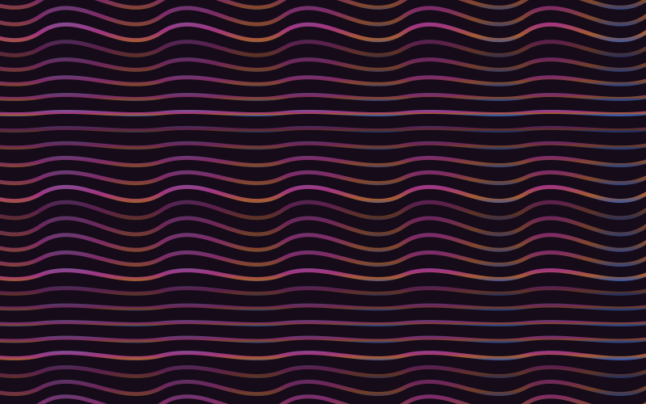<br><b>Psychedelic flow</b> · <code>psychflow</code><br><sub>Liquid stripes in purple, magenta, orange and blue that ripple and slowly change colour.<br>Try <code>/colors psych-currents</code></sub></td><td width="33%" valign="top"><br><b>Shooting stars</b> · <code>shootingstars</code><br><sub>A retro synthwave night: striped sunset sun, neon grid, twinkling sky and shooting stars.<br>Try <code>/colors shooting-star</code></sub></td><td width="33%" valign="top"><br><b>Neon grid</b> · <code>grid</code><br><sub>An 80s outrun floor rolling towards you under a striped sun.<br>Try <code>/colors synthwave</code></sub></td></tr>
<tr><td width="33%" valign="top">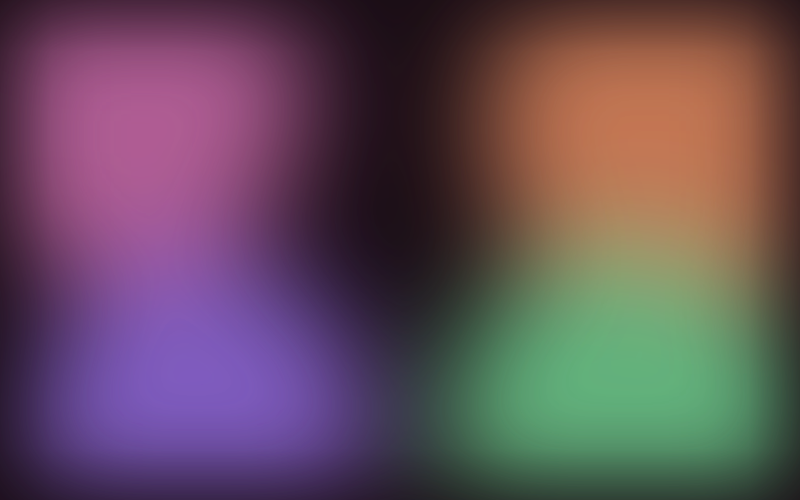<br><b>Mesh gradient</b> · <code>mesh</code><br><sub>Huge soft colour blobs drifting into each other, the trendy blurred-gradient look.<br>Try <code>/colors mesh-candy</code></sub></td><td width="33%" valign="top">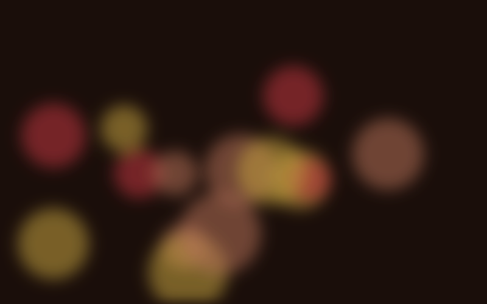<br><b>Lava lamp</b> · <code>lavalamp</code><br><sub>Glowing blobs that rise, stretch and sink like a lava lamp.<br>Try <code>/colors lava-lounge</code></sub></td><td width="33%" valign="top"><br><b>Northern lights</b> · <code>aurora</code><br><sub>Blurred ribbons of light swaying over a starry sky.<br>Try <code>/colors northern-lights</code></sub></td></tr>
<tr><td width="33%" valign="top"><br><b>Twinkling stars</b> · <code>stars</code><br><sub>A calm starfield with the odd shooting star.<br>Try <code>/colors galaxy</code></sub></td><td width="33%" valign="top"><br><b>Hyperspace</b> · <code>warp</code><br><sub>Star streaks rushing out of a vanishing point.<br>Try <code>/colors hyperspace</code></sub></td><td width="33%" valign="top"><br><b>Orbits</b> · <code>orbits</code><br><sub>Planets circling a glowing sun in the corner.<br>Try <code>/colors solar-system</code></sub></td></tr>
<tr><td width="33%" valign="top">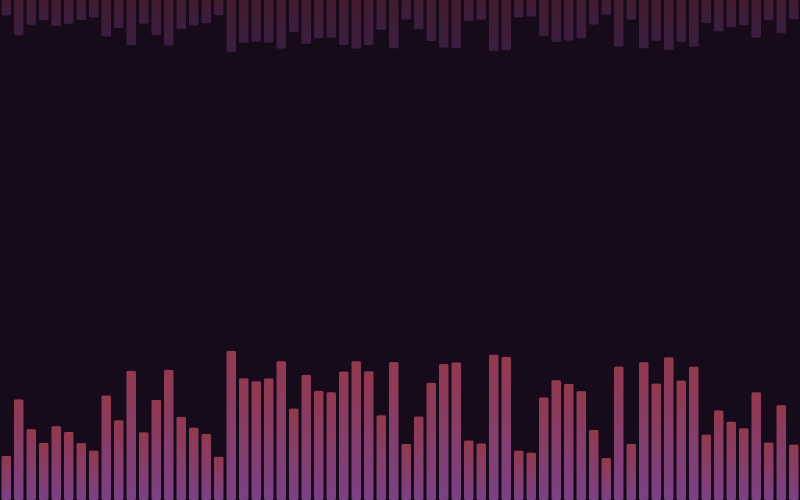<br><b>Equalizer</b> · <code>equalizer</code><br><sub>Bars bouncing like a music visualizer along the edges.<br>Try <code>/colors bass-drop</code></sub></td><td width="33%" valign="top"><br><b>Bokeh lights</b> · <code>bokeh</code><br><sub>Out-of-focus city lights gently pulsing.<br>Try <code>/colors city-bokeh</code></sub></td><td width="33%" valign="top">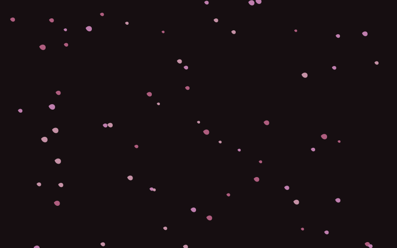<br><b>Falling petals</b> · <code>petals</code><br><sub>Cherry-blossom petals tumbling and spinning down.<br>Try <code>/colors sakura</code></sub></td></tr>
<tr><td width="33%" valign="top">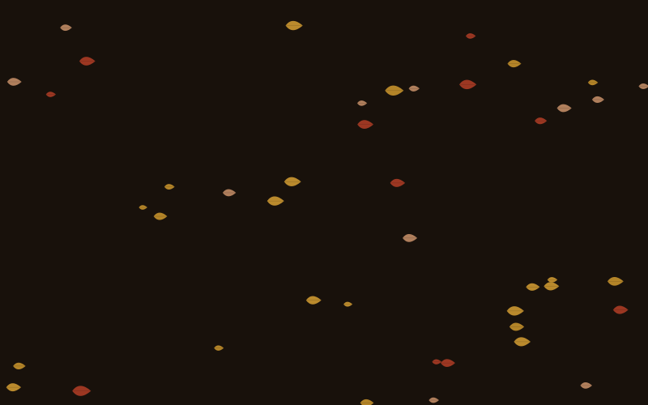<br><b>Autumn leaves</b> · <code>leaves</code><br><sub>Warm leaves drifting down in a breeze.<br>Try <code>/colors autumn-leaf</code></sub></td><td width="33%" valign="top">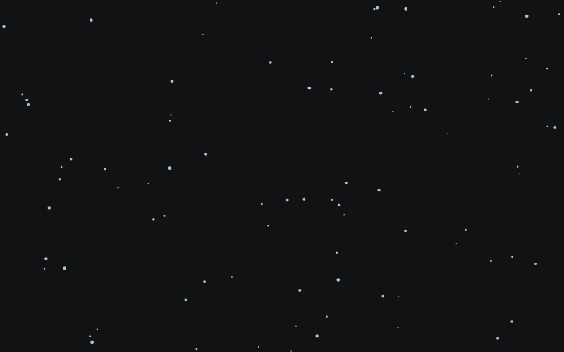<br><b>Snowfall</b> · <code>snow</code><br><sub>Soft flakes falling and swaying.<br>Try <code>/colors nordic-frost</code></sub></td><td width="33%" valign="top">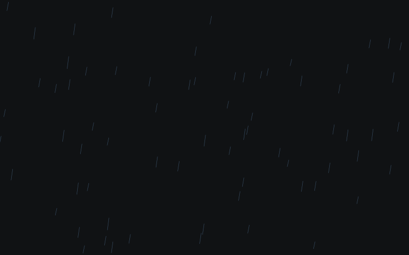<br><b>Soft rain</b> · <code>rain</code><br><sub>Light slanted rain, perfect for lofi focus.<br>Try <code>/colors storm-cloud</code></sub></td></tr>
<tr><td width="33%" valign="top">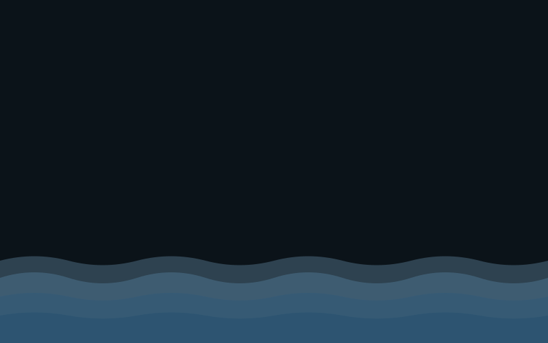<br><b>Ocean waves</b> · <code>waves</code><br><sub>Layered waves rolling along the bottom.<br>Try <code>/colors ocean-depth</code></sub></td><td width="33%" valign="top"><br><b>Ripples</b> · <code>ripples</code><br><sub>Rings spreading across still water.<br>Try <code>/colors koi-pond</code></sub></td><td width="33%" valign="top">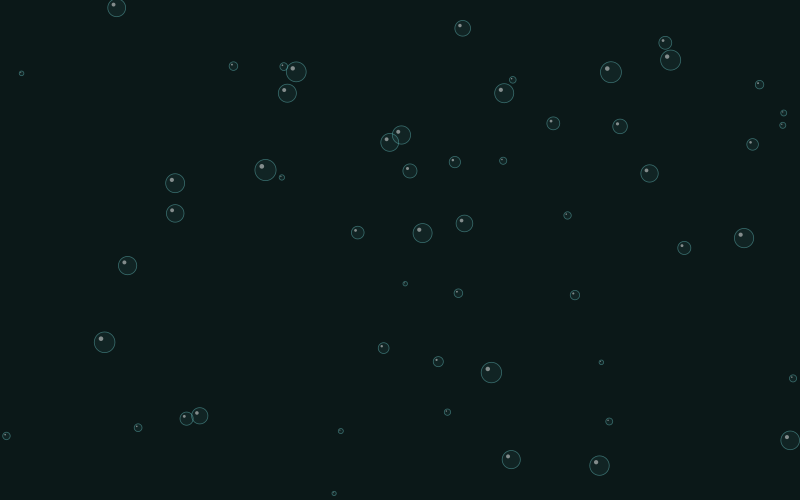<br><b>Rising bubbles</b> · <code>bubbles</code><br><sub>Shiny bubbles floating up.<br>Try <code>/colors mermaidcore</code></sub></td></tr>
<tr><td width="33%" valign="top"><br><b>Fireflies</b> · <code>fireflies</code><br><sub>Little glowing lights drifting and blinking.<br>Try <code>/colors olive</code></sub></td><td width="33%" valign="top"><br><b>Sunset clouds</b> · <code>sunset</code><br><sub>A glowing sun with clouds sliding past.<br>Try <code>/colors golden-hour</code></sub></td><td width="33%" valign="top">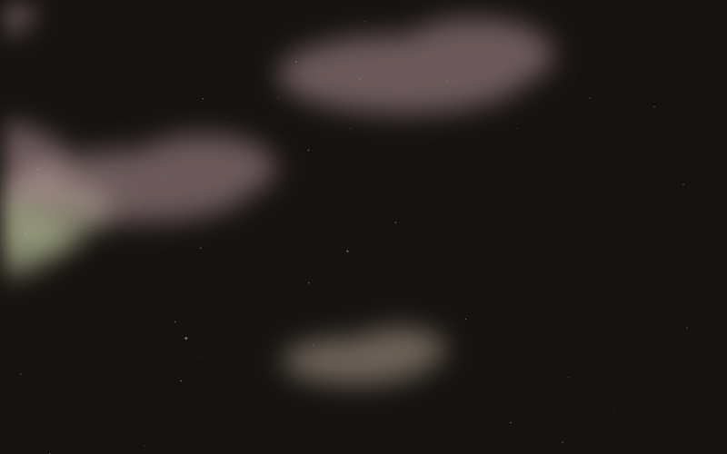<br><b>Dreamy clouds</b> · <code>clouds</code><br><sub>Big pastel clouds drifting slowly.<br>Try <code>/colors iced-latte</code></sub></td></tr>
<tr><td width="33%" valign="top"><br><b>Floating lanterns</b> · <code>lanterns</code><br><sub>Warm paper lanterns rising into the night.<br>Try <code>/colors kyoto</code></sub></td><td width="33%" valign="top">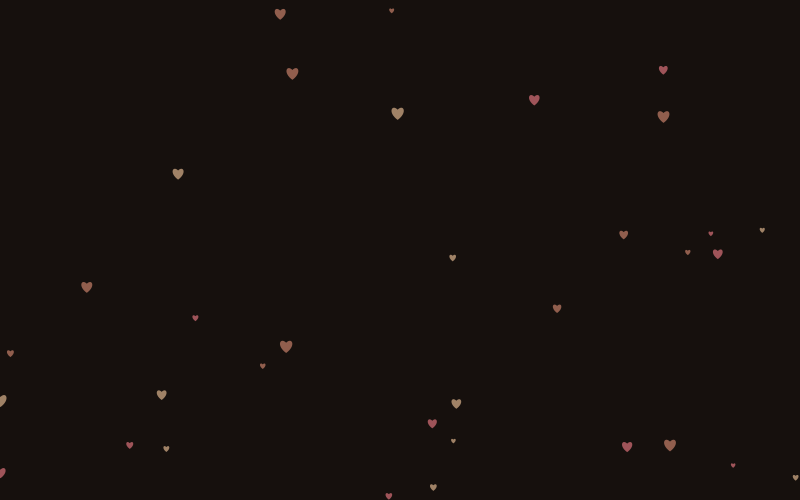<br><b>Floating hearts</b> · <code>hearts</code><br><sub>Little hearts floating upwards.<br>Try <code>/colors rose-gold</code></sub></td><td width="33%" valign="top">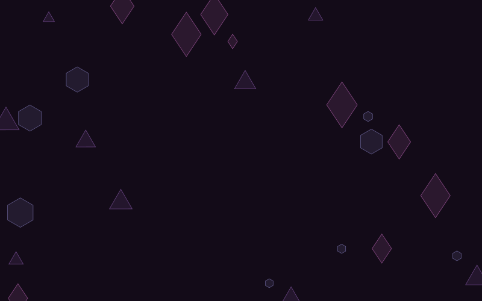<br><b>Drifting crystals</b> · <code>crystals</code><br><sub>Glassy gem shapes floating and turning.<br>Try <code>/colors amethyst</code></sub></td></tr>
<tr><td width="33%" valign="top">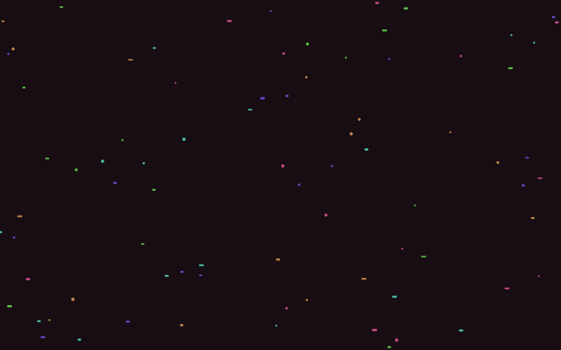<br><b>Confetti</b> · <code>confetti</code><br><sub>Colourful confetti tumbling down.<br>Try <code>/colors macaron</code></sub></td><td width="33%" valign="top">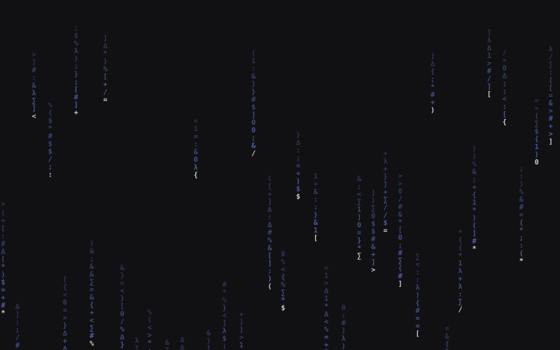<br><b>Code rain</b> · <code>coderain</code><br><sub>Columns of falling code symbols.<br>Try <code>/colors onyx</code></sub></td><td width="33%" valign="top">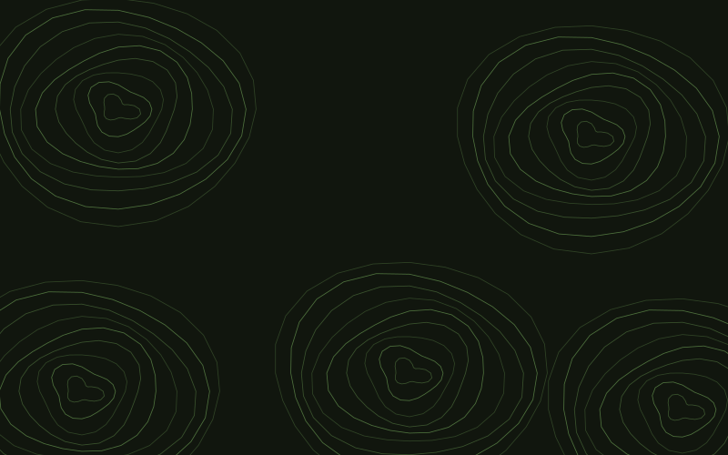<br><b>Topographic</b> · <code>contours</code><br><sub>Contour lines of a map, slowly breathing.<br>Try <code>/colors topo-map</code></sub></td></tr>
</table>

<sub>These previews are the real scenes, animated right here in the README. In the app they're tinted with whatever theme you choose, in light and dark mode.</sub>

## 🎨 Themes

209 themes in 10 collections. Each card shows the theme in light mode (top) and dark mode (bottom) with its accent colour.

| | |
| --- | --- |
| **✨ Motion vibes**: themes built around their animated scene, like `psych-currents`, `shooting-star`, `mesh-candy`, `hyperspace` and `bass-drop` | 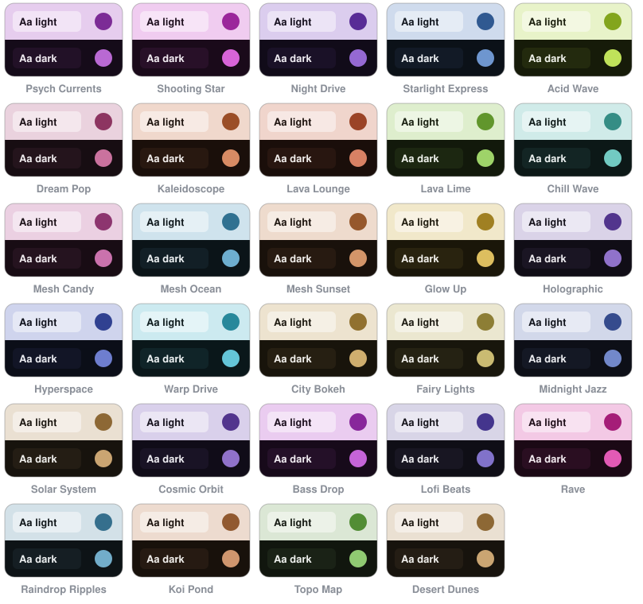 |
| **🌸 Soft pastels** | 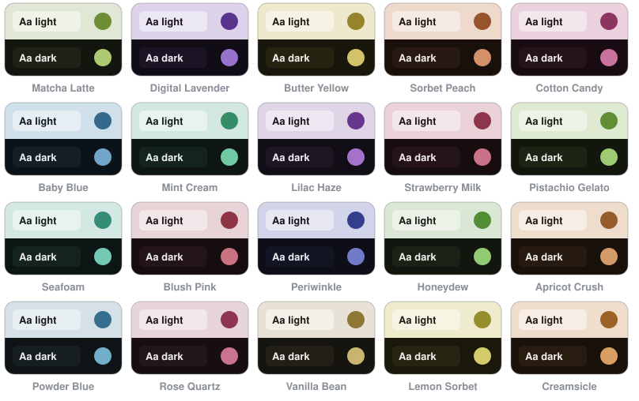 |
| **🍂 Earthy & cozy** |  |
| **⚡ Bold & vibrant** |  |
| **🌙 Dark & moody** | 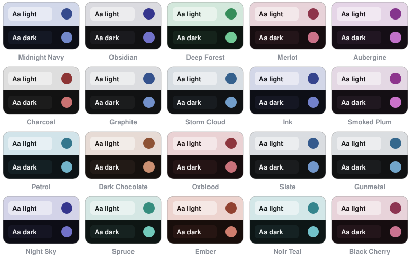 |
| **💿 Aesthetic vibes** |  |
| **🌿 Nature escapes** |  |
| **💎 Gemstones** | 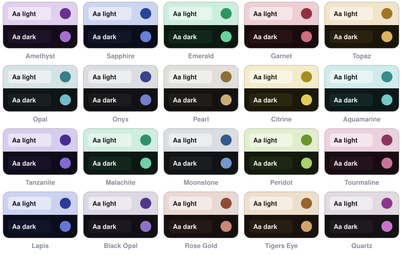 |
| **🧋 Sweets & drinks** | 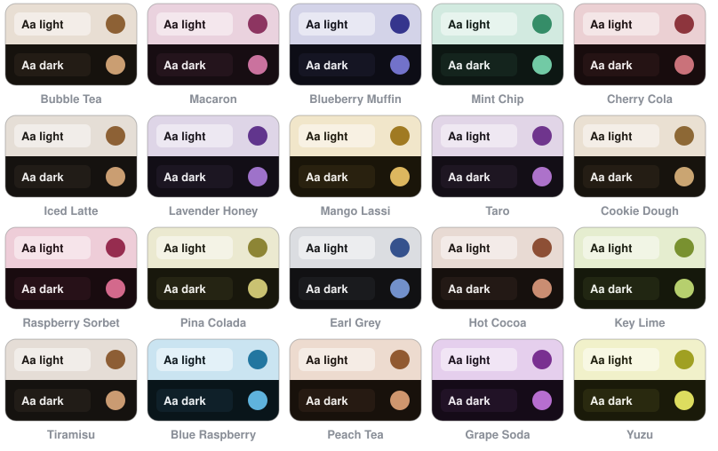 |
| **✈️ Places & journeys** | 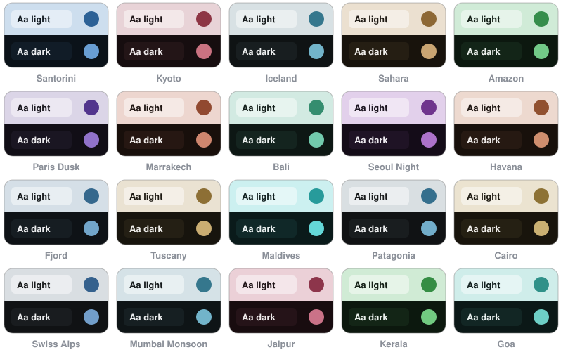 |

### Theme commands

| Command | What it does |
| --- | --- |
| `/colors` | List every theme and command |
| `/colors panel` | A side panel to pick themes by sight, star favourites and flip every setting |
| `/colors sakura` | Switch theme (`/colors golden hour` works too) |
| `/colors random` · `/colors surprise` | A random theme · a brand-new random palette |
| `/colors save my-blue` | Keep a custom or surprise colour as your own palette |
| `/colors favorite` · `/colors undo` | Star the current theme · go back |
| `/colors auto time` | Pastels in the morning, coastal by day, golden hour in the evening, midnight navy at night |
| `/colors auto daily` · `season` · `off` | A theme of the day · seasonal themes · back to your pick |
| `/colors contrast on` · `/colors code off` | Stronger borders · turn off matching code colours |

## 🖌️ Custom colours

1. **Pick a colour** from any colour picker, such as [coolors.co](https://coolors.co) or [Adobe Color](https://color.adobe.com).
2. **Type it:** `/colors custom #ff6b6b` (the `#` and the word `custom` are optional).
3. **Enjoy:** you get a full light and dark theme, readable contrast and a matching scene.

<p align="center"></p>

**Tips:** rich mid-tones like `#6c5ce7` make striking themes; pale colours give calm ones. Keep one with `/colors save <name>`. You can also **right-click** any hex colour in the chat and choose **Make a theme from it** (with `smart-menu` or `olive-theme`).

## 🧩 More customization

Each of these is its own plugin, and is also included in the all-in-one `olive-theme`. Add `list` to see every style and `off` to turn it off.

| Feature | Standalone command | In `olive-theme` | What it looks like |
| --- | --- | --- | --- |
| 📊 **Ambient bar** | `/bar focus 50` · `/bar clock 24h` · `/bar quote next` · `/bar off` | `/colors focus 50` … | `🌸 Sakura   🕐 9:42 PM · Thu 19 Nov   🍅 24:13 ⏸ ⏹   ✨ Small commits, big wins. ↻` |
| ⏳ **Spinners** (27) | `/spinner coffee` | `/colors spinner coffee` | *Brewing ☕* · *Wishing 🌠* · *Swirling 🌀* · *Leveling up 🎮* |
| ⌨️ **Prompt colors** (24) | `/prompt-colors neon` | `/colors prompt neon` | `/commands`, `@files`, `app.py`, links, `TODO`, numbers each in their own colour |
| 🧰 **Tool cards** (22) | `/tool-cards neon` | `/colors cards neon` | `╭ 💻 Bash  ✓ done ╮` with a `██████████░ 18/20 passed` test bar |
| 💬 **Message badges** (22) | `/badges space` | `/colors badges space` | `👩‍🚀 You` · `🛸 Claude` |
| 🔔 **Sound packs** (25) | `/sounds arcade` · `/sounds voice on` | `/colors sounds arcade` · `/colors voice on` | Different sounds for done, error and question; your Mac can say "All done!" |
| 📈 **Session stats** | `/session-stats` | `/colors stats` | Time, turns, tool bar chart, files changed, context %, cost |
| 🖱️ **Smart menu** | right-click selected text | right-click | 💡 Explain · 🐞 Find bugs · ✨ Improve · 🧒 Explain simply · 🎨 Make a theme |

<details>
<summary>All the style names</summary>

- **Spinners:** sparkle, coffee, tea, space, synthwave, psych, shootingstar, ocean, forest, sakura, autumn, winter, baking, cooking, music, lofi, gaming, magic, robot, science, cat, dog, ninja, pirate, garden, zen, dots (or `auto` to match your theme)
- **Prompt colors:** neon, pastel, synthwave, ocean, forest, sunset, candy, dracula, nord, monokai, solar, gruvbox, matrix, sakura, autumn, ice, gold, cyber, lavender, citrus, mono, retro, vapor, earth
- **Tool cards:** soft, neon, ocean, forest, sunset, lavender, gold, mint, cherry, ice, boxy, double, bold, classic, terminal, synthwave, dracula, nord, gruvbox, cyber, minimal, emoji
- **Message badges:** classic, sparkle, space, synthwave, chat, cozy, nature, ocean, sakura, cats, gaming, music, magic, robots, royal, minimal, arrows, brackets, hearts, weather, food, sports
- **Sound packs:** chime, bells, marimba, arcade, coin, levelup, synthwave, dreamy, harp, zen, bubbles, piano, doorbell, sparkle, robot, lofi, space, kalimba, pop, victory, ocean, retro, gentle, jazz, wind (plus `classic`)

</details>

## 📋 Every theme

Click a collection to see each theme, its command and its key colours.

<details>
<summary><b>Soft pastels</b> — 20 themes</summary>

| Theme | Command | Light background | Dark background | Accent |
| --- | --- | --- | --- | --- |
| **Matcha Latte** | `/colors matcha-latte` |  |  |  |
| **Digital Lavender** | `/colors digital-lavender` |  |  |  |
| **Butter Yellow** | `/colors butter-yellow` |  |  |  |
| **Sorbet Peach** | `/colors sorbet-peach` |  |  |  |
| **Cotton Candy** | `/colors cotton-candy` |  |  |  |
| **Baby Blue** | `/colors baby-blue` |  |  |  |
| **Mint Cream** | `/colors mint-cream` |  |  |  |
| **Lilac Haze** | `/colors lilac-haze` |  |  |  |
| **Strawberry Milk** | `/colors strawberry-milk` |  |  |  |
| **Pistachio Gelato** | `/colors pistachio-gelato` |  |  |  |
| **Seafoam** | `/colors seafoam` |  |  |  |
| **Blush Pink** | `/colors blush-pink` |  |  |  |
| **Periwinkle** | `/colors periwinkle` |  |  |  |
| **Honeydew** | `/colors honeydew` |  |  |  |
| **Apricot Crush** | `/colors apricot-crush` |  |  |  |
| **Powder Blue** | `/colors powder-blue` |  |  |  |
| **Rose Quartz** | `/colors rose-quartz` |  |  |  |
| **Vanilla Bean** | `/colors vanilla-bean` |  |  |  |
| **Lemon Sorbet** | `/colors lemon-sorbet` |  |  |  |
| **Creamsicle** | `/colors creamsicle` |  |  |  |

</details>

<details>
<summary><b>Earthy & cozy</b> — 20 themes</summary>

| Theme | Command | Light background | Dark background | Accent |
| --- | --- | --- | --- | --- |
| **Olive** | `/colors olive` |  |  |  |
| **Espresso** | `/colors espresso` |  |  |  |
| **Terracotta** | `/colors terracotta` |  |  |  |
| **Clay Pot** | `/colors clay-pot` |  |  |  |
| **Sage Green** | `/colors sage-green` |  |  |  |
| **Moss Stone** | `/colors moss-stone` |  |  |  |
| **Oat Milk** | `/colors oat-milk` |  |  |  |
| **Cinnamon Roll** | `/colors cinnamon-roll` |  |  |  |
| **Chai** | `/colors chai` |  |  |  |
| **Caramel Drizzle** | `/colors caramel-drizzle` |  |  |  |
| **Desert Sand** | `/colors desert-sand` |  |  |  |
| **Burnt Sienna** | `/colors burnt-sienna` |  |  |  |
| **Cedarwood** | `/colors cedarwood` |  |  |  |
| **Walnut** | `/colors walnut` |  |  |  |
| **Mushroom** | `/colors mushroom` |  |  |  |
| **Linen** | `/colors linen` |  |  |  |
| **Khaki Trail** | `/colors khaki-trail` |  |  |  |
| **Hazelnut** | `/colors hazelnut` |  |  |  |
| **Tobacco** | `/colors tobacco` |  |  |  |
| **Fig** | `/colors fig` |  |  |  |

</details>

<details>
<summary><b>Bold & vibrant</b> — 20 themes</summary>

| Theme | Command | Light background | Dark background | Accent |
| --- | --- | --- | --- | --- |
| **Electric Blue** | `/colors electric-blue` |  |  |  |
| **Hot Pink** | `/colors hot-pink` |  |  |  |
| **Cherry Red** | `/colors cherry-red` |  |  |  |
| **Tangerine Dream** | `/colors tangerine-dream` |  |  |  |
| **Lime Zest** | `/colors lime-zest` |  |  |  |
| **Cobalt** | `/colors cobalt` |  |  |  |
| **Ultraviolet** | `/colors ultraviolet` |  |  |  |
| **Emerald City** | `/colors emerald-city` |  |  |  |
| **Saffron** | `/colors saffron` |  |  |  |
| **Fuchsia Pop** | `/colors fuchsia-pop` |  |  |  |
| **Turquoise** | `/colors turquoise` |  |  |  |
| **Scarlet** | `/colors scarlet` |  |  |  |
| **Royal Purple** | `/colors royal-purple` |  |  |  |
| **Sunflower** | `/colors sunflower` |  |  |  |
| **Jade Glow** | `/colors jade-glow` |  |  |  |
| **Amber Glow** | `/colors amber-glow` |  |  |  |
| **Magenta Rush** | `/colors magenta-rush` |  |  |  |
| **Ocean Depth** | `/colors ocean-depth` |  |  |  |
| **Ruby** | `/colors ruby` |  |  |  |
| **Kiwi** | `/colors kiwi` |  |  |  |

</details>

<details>
<summary><b>Dark & moody</b> — 20 themes</summary>

| Theme | Command | Light background | Dark background | Accent |
| --- | --- | --- | --- | --- |
| **Midnight Navy** | `/colors midnight-navy` |  |  |  |
| **Obsidian** | `/colors obsidian` |  |  |  |
| **Deep Forest** | `/colors deep-forest` |  |  |  |
| **Merlot** | `/colors merlot` |  |  |  |
| **Aubergine** | `/colors aubergine` |  |  |  |
| **Charcoal** | `/colors charcoal` |  |  |  |
| **Graphite** | `/colors graphite` |  |  |  |
| **Storm Cloud** | `/colors storm-cloud` |  |  |  |
| **Ink** | `/colors ink` |  |  |  |
| **Smoked Plum** | `/colors smoked-plum` |  |  |  |
| **Petrol** | `/colors petrol` |  |  |  |
| **Dark Chocolate** | `/colors dark-chocolate` |  |  |  |
| **Oxblood** | `/colors oxblood` |  |  |  |
| **Slate** | `/colors slate` |  |  |  |
| **Gunmetal** | `/colors gunmetal` |  |  |  |
| **Night Sky** | `/colors night-sky` |  |  |  |
| **Spruce** | `/colors spruce` |  |  |  |
| **Ember** | `/colors ember` |  |  |  |
| **Noir Teal** | `/colors noir-teal` |  |  |  |
| **Black Cherry** | `/colors black-cherry` |  |  |  |

</details>

<details>
<summary><b>Aesthetic vibes</b> — 20 themes</summary>

| Theme | Command | Light background | Dark background | Accent |
| --- | --- | --- | --- | --- |
| **Y2k** | `/colors y2k` |  |  |  |
| **Vaporwave** | `/colors vaporwave` |  |  |  |
| **Synthwave** | `/colors synthwave` |  |  |  |
| **Cyberpunk** | `/colors cyberpunk` |  |  |  |
| **Cottagecore** | `/colors cottagecore` |  |  |  |
| **Dark Academia** | `/colors dark-academia` |  |  |  |
| **Coastal** | `/colors coastal` |  |  |  |
| **Mermaidcore** | `/colors mermaidcore` |  |  |  |
| **Cyber Mint** | `/colors cyber-mint` |  |  |  |
| **Aurora** | `/colors aurora` |  |  |  |
| **Sunset Boulevard** | `/colors sunset-boulevard` |  |  |  |
| **Golden Hour** | `/colors golden-hour` |  |  |  |
| **Nordic Frost** | `/colors nordic-frost` |  |  |  |
| **Tokyo Neon** | `/colors tokyo-neon` |  |  |  |
| **Miami Nights** | `/colors miami-nights` |  |  |  |
| **Lofi** | `/colors lofi` |  |  |  |
| **Retro 80s** | `/colors retro-80s` |  |  |  |
| **Solarpunk** | `/colors solarpunk` |  |  |  |
| **Pink Power** | `/colors pink-power` |  |  |  |
| **Galaxy** | `/colors galaxy` |  |  |  |

</details>

<details>
<summary><b>Nature escapes</b> — 20 themes</summary>

| Theme | Command | Light background | Dark background | Accent |
| --- | --- | --- | --- | --- |
| **Lagoon** | `/colors lagoon` |  |  |  |
| **Tropical** | `/colors tropical` |  |  |  |
| **Zen Garden** | `/colors zen-garden` |  |  |  |
| **Moonlight** | `/colors moonlight` |  |  |  |
| **Sakura** | `/colors sakura` |  |  |  |
| **Rainforest** | `/colors rainforest` |  |  |  |
| **Glacier** | `/colors glacier` |  |  |  |
| **Volcano** | `/colors volcano` |  |  |  |
| **Savanna** | `/colors savanna` |  |  |  |
| **Bamboo** | `/colors bamboo` |  |  |  |
| **Tundra** | `/colors tundra` |  |  |  |
| **Coral Reef** | `/colors coral-reef` |  |  |  |
| **Lotus** | `/colors lotus` |  |  |  |
| **Pine Forest** | `/colors pine-forest` |  |  |  |
| **Meadow** | `/colors meadow` |  |  |  |
| **Desert Bloom** | `/colors desert-bloom` |  |  |  |
| **Northern Lights** | `/colors northern-lights` |  |  |  |
| **Ocean Breeze** | `/colors ocean-breeze` |  |  |  |
| **Wildflower** | `/colors wildflower` |  |  |  |
| **Autumn Leaf** | `/colors autumn-leaf` |  |  |  |

</details>

<details>
<summary><b>Gemstones</b> — 20 themes</summary>

| Theme | Command | Light background | Dark background | Accent |
| --- | --- | --- | --- | --- |
| **Amethyst** | `/colors amethyst` |  |  |  |
| **Sapphire** | `/colors sapphire` |  |  |  |
| **Emerald** | `/colors emerald` |  |  |  |
| **Garnet** | `/colors garnet` |  |  |  |
| **Topaz** | `/colors topaz` |  |  |  |
| **Opal** | `/colors opal` |  |  |  |
| **Onyx** | `/colors onyx` |  |  |  |
| **Pearl** | `/colors pearl` |  |  |  |
| **Citrine** | `/colors citrine` |  |  |  |
| **Aquamarine** | `/colors aquamarine` |  |  |  |
| **Tanzanite** | `/colors tanzanite` |  |  |  |
| **Malachite** | `/colors malachite` |  |  |  |
| **Moonstone** | `/colors moonstone` |  |  |  |
| **Peridot** | `/colors peridot` |  |  |  |
| **Tourmaline** | `/colors tourmaline` |  |  |  |
| **Lapis** | `/colors lapis` |  |  |  |
| **Black Opal** | `/colors black-opal` |  |  |  |
| **Rose Gold** | `/colors rose-gold` |  |  |  |
| **Tigers Eye** | `/colors tigers-eye` |  |  |  |
| **Quartz** | `/colors quartz` |  |  |  |

</details>

<details>
<summary><b>Sweets & drinks</b> — 20 themes</summary>

| Theme | Command | Light background | Dark background | Accent |
| --- | --- | --- | --- | --- |
| **Bubble Tea** | `/colors bubble-tea` |  |  |  |
| **Macaron** | `/colors macaron` |  |  |  |
| **Blueberry Muffin** | `/colors blueberry-muffin` |  |  |  |
| **Mint Chip** | `/colors mint-chip` |  |  |  |
| **Cherry Cola** | `/colors cherry-cola` |  |  |  |
| **Iced Latte** | `/colors iced-latte` |  |  |  |
| **Lavender Honey** | `/colors lavender-honey` |  |  |  |
| **Mango Lassi** | `/colors mango-lassi` |  |  |  |
| **Taro** | `/colors taro` |  |  |  |
| **Cookie Dough** | `/colors cookie-dough` |  |  |  |
| **Raspberry Sorbet** | `/colors raspberry-sorbet` |  |  |  |
| **Pina Colada** | `/colors pina-colada` |  |  |  |
| **Earl Grey** | `/colors earl-grey` |  |  |  |
| **Hot Cocoa** | `/colors hot-cocoa` |  |  |  |
| **Key Lime** | `/colors key-lime` |  |  |  |
| **Tiramisu** | `/colors tiramisu` |  |  |  |
| **Blue Raspberry** | `/colors blue-raspberry` |  |  |  |
| **Peach Tea** | `/colors peach-tea` |  |  |  |
| **Grape Soda** | `/colors grape-soda` |  |  |  |
| **Yuzu** | `/colors yuzu` |  |  |  |

</details>

<details>
<summary><b>Places & journeys</b> — 20 themes</summary>

| Theme | Command | Light background | Dark background | Accent |
| --- | --- | --- | --- | --- |
| **Santorini** | `/colors santorini` |  |  |  |
| **Kyoto** | `/colors kyoto` |  |  |  |
| **Iceland** | `/colors iceland` |  |  |  |
| **Sahara** | `/colors sahara` |  |  |  |
| **Amazon** | `/colors amazon` |  |  |  |
| **Paris Dusk** | `/colors paris-dusk` |  |  |  |
| **Marrakech** | `/colors marrakech` |  |  |  |
| **Bali** | `/colors bali` |  |  |  |
| **Seoul Night** | `/colors seoul-night` |  |  |  |
| **Havana** | `/colors havana` |  |  |  |
| **Fjord** | `/colors fjord` |  |  |  |
| **Tuscany** | `/colors tuscany` |  |  |  |
| **Maldives** | `/colors maldives` |  |  |  |
| **Patagonia** | `/colors patagonia` |  |  |  |
| **Cairo** | `/colors cairo` |  |  |  |
| **Swiss Alps** | `/colors swiss-alps` |  |  |  |
| **Mumbai Monsoon** | `/colors mumbai-monsoon` |  |  |  |
| **Jaipur** | `/colors jaipur` |  |  |  |
| **Kerala** | `/colors kerala` |  |  |  |
| **Goa** | `/colors goa` |  |  |  |

</details>

<details>
<summary><b>Motion vibes</b> — 29 themes</summary>

| Theme | Command | Light background | Dark background | Accent |
| --- | --- | --- | --- | --- |
| **Psych Currents** | `/colors psych-currents` |  |  |  |
| **Shooting Star** | `/colors shooting-star` |  |  |  |
| **Night Drive** | `/colors night-drive` |  |  |  |
| **Starlight Express** | `/colors starlight-express` |  |  |  |
| **Acid Wave** | `/colors acid-wave` |  |  |  |
| **Dream Pop** | `/colors dream-pop` |  |  |  |
| **Kaleidoscope** | `/colors kaleidoscope` |  |  |  |
| **Lava Lounge** | `/colors lava-lounge` |  |  |  |
| **Lava Lime** | `/colors lava-lime` |  |  |  |
| **Chill Wave** | `/colors chill-wave` |  |  |  |
| **Mesh Candy** | `/colors mesh-candy` |  |  |  |
| **Mesh Ocean** | `/colors mesh-ocean` |  |  |  |
| **Mesh Sunset** | `/colors mesh-sunset` |  |  |  |
| **Glow Up** | `/colors glow-up` |  |  |  |
| **Holographic** | `/colors holographic` |  |  |  |
| **Hyperspace** | `/colors hyperspace` |  |  |  |
| **Warp Drive** | `/colors warp-drive` |  |  |  |
| **City Bokeh** | `/colors city-bokeh` |  |  |  |
| **Fairy Lights** | `/colors fairy-lights` |  |  |  |
| **Midnight Jazz** | `/colors midnight-jazz` |  |  |  |
| **Solar System** | `/colors solar-system` |  |  |  |
| **Cosmic Orbit** | `/colors cosmic-orbit` |  |  |  |
| **Bass Drop** | `/colors bass-drop` |  |  |  |
| **Lofi Beats** | `/colors lofi-beats` |  |  |  |
| **Rave** | `/colors rave` |  |  |  |
| **Raindrop Ripples** | `/colors raindrop-ripples` |  |  |  |
| **Koi Pond** | `/colors koi-pond` |  |  |  |
| **Topo Map** | `/colors topo-map` |  |  |  |
| **Desert Dunes** | `/colors desert-dunes` |  |  |  |

</details>


## ⚠️ Limitations

Good to know before you install:

- **Claude Code only.** These are Claude Code plugins. They don't change the normal Claude chat on claude.ai or the Chat tab of the desktop app, which only offer Light, Dark and System.
- **Themes, scenes and the mouse glow need the Claude desktop app.** The terminal and the VS Code / JetBrains extensions don't draw themes or backgrounds. The ambient bar, spinners, prompt colours, tool cards, badges, sounds and stats work in the terminal too.
- **Phones:** the Claude mobile app can't install plugins. It shows the theme only when you open a session running on a computer that has the plugin.
- **A recent Claude Code is required.** These use Claude Code's plugin hooks, so update Claude Code if a command doesn't appear.
- **New sessions only.** After installing or updating, start a new session. Already-open sessions don't pick up the plugin.
- **Install one way, not both.** Installing `olive-theme` and a separate plugin together shows that feature twice.
- **Settings are per plugin.** The separate plugins each remember their own settings; they don't share them with `olive-theme`.
- **The mouse glow is desktop-app only**, and scenes stand still if your Mac has **Reduce Motion** turned on.
- **Animated scenes use a little GPU and battery.** Turn them off any time with `/colors scene off`.
- **Some parts keep Claude's own look:** permission prompts, and the desktop app's step descriptions in the spinner (it adds the icon instead).
- **Code highlighting styles** depend on what the app offers. If it doesn't know one, it keeps its usual code colours.
- **The theme picker and stats panels** open in the desktop app or a fullscreen terminal.
- **Sounds and voice** play on macOS. Linux and Windows terminals stay silent, and a voice name must be installed on your Mac.
- **Auto themes** follow your computer's clock; seasons follow the northern hemisphere.
- **Session stats** start fresh in each session.
- **Make a theme from a colour** in the right-click menu needs `olive-theme` or `color-themes` installed too.
- **Plugin APIs can change.** These use Claude Code's newer plugin features, so a future Claude Code update may need a plugin update.

---

<p align="center">
  Made with 💚 by <a href="https://github.com/notchkillerAI">Arpan Bhattacharya</a>
</p>
